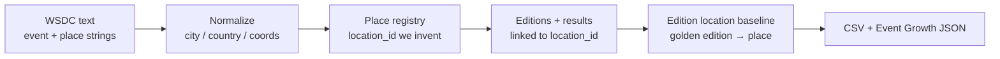

# Event locations — collaborator guide

Cleaned WSDC event locations (geo behind Event Growth / Trends Monitor).  
CSV = source of truth; `event_growth.json` = dashboard extract. Pipeline feeds the analytics site.

## Live

- [Event Growth (EN)](https://wsdc-analytics.github.io/event_growth_dashboard_en.html)

## How we build the location layer

### The problem

WSDC public results give **text** for where an event happened (“Seattle, WA”, “Toulouse, France”, …).  
They do **not** give a stable place id.

Without that, the same city can appear under many spellings, two different cities can look similar, and a wrong shared place can stick to the wrong event. For maps, trends, and year-over-year geography we need something firmer than raw strings.

### What we invent (and why)

We maintain our own place registry and ids:

| Idea | Meaning |
|------|---------|
| **`location_id`** | Stable id for a **place** (city / region / country + coordinates) that **we** assign and keep |
| **`event_id`** | Stable id for an **event brand** (from WSDC / our catalog) |
| **Edition** | One running of a brand: `event_id` + year + month |
| **Baseline** | Frozen “this edition was here” link: edition → `location_id` |

So: WSDC supplies names and messy place text; we normalize places, mint `location_id`s, and attach each edition (and result rows) to those ids.

### Process (plain language)

1. **Ingest** — Pull dancer/results/event text from WSDC (and schedule text when useful).
2. **Normalize place strings** — Clean city / state / country spelling; fill coordinates when we can.
3. **Build / reuse the place registry** — Same normalized place → same `location_id`; new place → new id (we do not rely on WSDC for this key).
4. **Attach places to results & editions** — Map each result’s location text (and known overrides) onto a `location_id`; editions carry the place for that weekend.
5. **Freeze a baseline** — For each known `(event_id, year, month)` store the golden `location_id`. Later loads compare against it so a bad reuse of another city’s id shows up as drift instead of silently rewriting history.
6. **Publish** — Export CSVs for Tableau / collaborators; build `event_growth.json` for the public Event Growth dashboard.

Manual overrides exist when WSDC reused another event’s place (wrong shared id). Those are researched fixes, not automatic guesses.



### Mental model

```text
Event brand (event_id)
   └── Edition (year, month)
          └── location_id  →  city / country / lat / lon
```

Baseline remembers the edition→place link so geography stays comparable across pipeline runs.

More detail for maintainers: [Geography transform](../transform/geography.md), [Geo dedup policy](../policies/event-geo-dedup.md).

## Files

| File | Use |
|------|-----|
| [`location_info.csv`](https://github.com/zlat1109/wsdc-data-pipeline/blob/main/data/location_info.csv) | Canonical places: city / state / country + lat/lon |
| [`event_editions.csv`](https://github.com/zlat1109/wsdc-data-pipeline/blob/main/data/event_editions.csv) | Edition → `location_id` + place fields |
| [`edition_location_baseline.csv`](https://github.com/zlat1109/wsdc-data-pipeline/blob/main/data/edition_location_baseline.csv) | Golden edition→location baseline |
| [`event_growth.json`](https://github.com/wsdc-analytics/wsdc-analytics.github.io/blob/main/static/data/event_growth.json) | Dashboard `editions[]` geo payload |

Raw CSV/JSON: in the GitHub URL, replace `/blob/main/` with `/raw/main/`.

Optional schema overview (no credentials): [Database docs](../database/index.md).

## Data dictionary

### `location_info.csv`

| Column | Meaning |
|--------|---------|
| `location_id` | Stable place id **we** maintain |
| `event_city` / `event_state` / `event_country` | Normalized place parts |
| `latitude` / `longitude` | Coordinates |
| `event_location` | Display / raw-ish location string |
| `event_location_standardized` | Standardized label |
| `coordinates_valid` | Flag for usable coordinates |

### `event_editions.csv` (location-related)

| Column | Meaning |
|--------|---------|
| `edition_id` | Edition key |
| `event_id` / `event_name` | Event identity |
| `event_year` / `event_month` | Edition time |
| `location_id` | Link to `location_info` |
| `place_city` / `place_state` / `place_country` | Place on that edition |
| `location_raw` / `typical_location` | Raw / catalog typical strings |

### `event_growth.json` → `editions[]` (geo)

| Field | Meaning |
|-------|---------|
| `event_id` / `name` / `year` / `month` | Edition identity |
| `city` / `state` / `country` / `continent` | Place |
| `lat` / `lon` | Coordinates on the charts |
| `city_lat` / `city_lon` | City-level coordinates when present |
| `address` / `hotel` | Venue text when enriched |
| `geo_source` | Provenance (e.g. `wsdc_venue`) |
| `geo_fix` / `approx` | Quality / approximation flags |

## Join

```
event_editions.location_id  →  location_info.location_id
```

For growth UI parity: `event_id` + `year` + `month` (name as a check).

## Out of scope

- DB credentials / direct Supabase access  
- Full parser / CI runbooks  
- Competition Results warehouse (separate; data ingest later, not repo merge)
